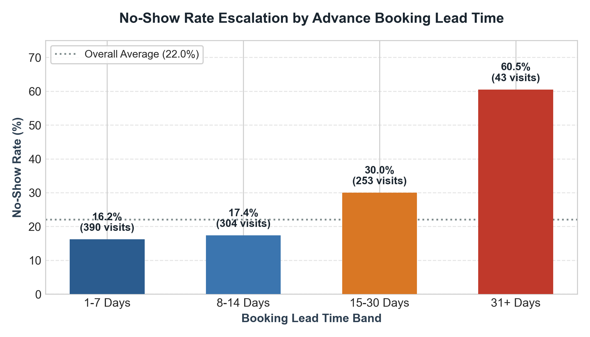
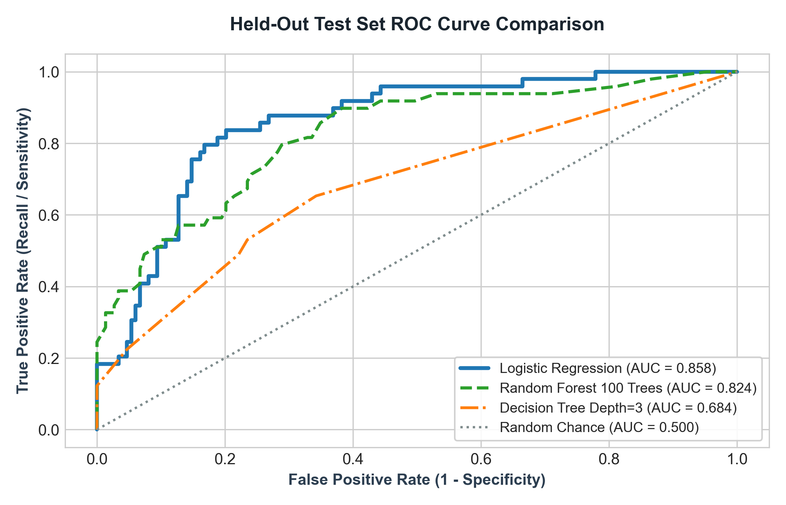
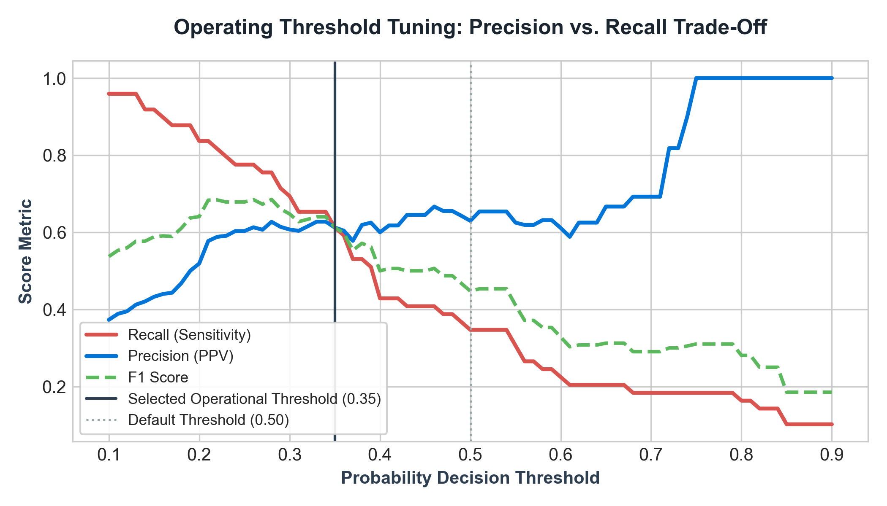

# CareLoop Clinics: No-Show Guard
> **From raw bookings to an interpretable risk model and an AI-assisted follow-up review**  
> *IIT Roorkee & Masai School — Data Science & AI Capstone Project*

**Public Repository URL:** https://github.com/sdn9300/careloop-noshow-guard  
**Executive Report PDF:** [CareLoop_NoShowGuard_Executive_Report.pdf](CareLoop_NoShowGuard_Executive_Report.pdf)

---

## 1. Project Overview & Business Context

CareLoop Clinics operates eight outpatient healthcare centres across six Indian cities:
* **Pune:** Hadapsar Care Centre, Kothrud Family Clinic
* **Jaipur:** Malviya Nagar Clinic, Vaishali Nagar Clinic
* **Indore:** Vijay Nagar Clinic
* **Kochi:** Edappally Medical Centre Kochi
* **Lucknow:** Gomti Nagar Care Point
* **Nagpur:** Sitabuldi Health Point

### The Business Challenge
In outpatient healthcare, every missed appointment represents an empty doctor slot that another patient could have used. Currently, clinic front desks only identify no-shows after the working day has ended. Furthermore, while the call-centre team records brief qualitative follow-up notes after speaking with patients who missed visits, these notes are never aggregated or analyzed systematically at scale.

### The Core Business Question
> **"Which appointments are most likely to be missed, why do patients miss them, and what should CareLoop do first?"**

### The Operational Prediction Point
Risk scores are generated on the **evening before the appointment** (after that day’s automated reminders have been sent or skipped). At this exact moment, all features—including reminder status and historical no-show counts—are known, allowing clinic front desk teams to prioritize personal telephone calls to the riskiest patients.

### Data Provenance & Simulated Business Context
* **Simulated Healthcare Network:** CareLoop Clinics is a simulated outpatient network designed to model realistic operational dynamics, consultation fees, and patient scheduling behavior across Indian Tier-1 and Tier-2 clinical facilities.
* **Controlled Synthetic Benchmark:** The core appointment booking logs (`appointments.csv`), clinic master profiles (`clinics.csv`), and unstructured qualitative call-centre notes (`followup_notes.csv`) are controlled synthetic benchmark datasets calibrated to project specifications established by IIT Roorkee and Masai School.
* **Live Environmental Telemetry:** In Part 1 (Task 1.5), clinic latitude and longitude coordinates were coupled with live, real-time ambient weather telemetry queried via REST API from the **Open-Meteo API**, enriching clinic master records (`clinics_enriched.csv`) with live ambient temperature (°C).

---

## 2. End-to-End System Architecture

```
Raw Data Pack (appointments.csv, clinics.csv, followup_notes.csv)
   │
   ├── Part 1: Python & Data Foundations (01_ingest_clean.ipynb)
   │     ├── Low-level CSV type parsing & defensive rejection (rejected_rows.json)
   │     ├── Multi-pass pandas cleaning, deduplication & gap imputation
   │     ├── Tukey IQR outlier fencing & vectorized NumPy audits
   │     ├── Open-Meteo REST API live weather enrichment (clinics_enriched.csv)
   │     └── Clean export (appointments_clean.csv) & DB ingestion script (load_data.sql)
   │
   ├── Part 2: SQL Analytics & Relational Integrity (02_queries.sql)
   │     ├── Relational schema creation (PK/FK integrity checks & duplicate key handling)
   │     ├── Clinic no-show clustering & sample size filtering (HAVING >= 95)
   │     ├── Lead-time banding via CASE WHEN (1-7d, 8-14d, 15-30d, 31+d)
   │     ├── Monthly trend tracking via LAG() window functions
   │     └── Intra-city clinic ranking via RANK() OVER (PARTITION BY city)
   │
   ├── Part 3: Machine Learning & Predictive Risk Scoring (03_model.ipynb)
   │     ├── Leak-free train/test partition (80/20, seed 42)
   │     ├── Scaled Logistic Regression & odds ratio interpretability
   │     ├── Decision Tree overfitting diagnostics & Random Forest ensembles
   │     ├── 5-Fold cross-validation & hyperparameter tuning
   │     ├── Threshold optimization (0.50 vs 0.35) prioritizing clinical recall
   │     ├── Final hold-out evaluation (test_risk_scores.csv)
   │     └── Methodological Rigor: Leak-Free Pipeline & Chronological Validation (Task 3.6)
   │
   ├── Part 4: Generative AI Follow-Up Review (04_genai.ipynb)
   │     ├── Gemini Flash integration via Google GenAI SDK
   │     ├── CRAFT structured prompting with strict JSON schema
   │     ├── Pydantic v2 data model validation (FollowupInsight)
   │     ├── Rate-limit throttling (time.sleep(13)) & blank-note bypass (N004)
   │     └── Adversarial fault-injection & Hinglish evaluation (notes_analysed.csv)
   │
   └── Strategic Synthesis & Executive Deliverables
         ├── Crosstab: root_cause vs reminder_sent → Actionable Clinic Strategy
         ├── Visual Report Assets: report_assets/ (Lead Time, ROC Curves, Threshold Tuning)
         └── Publication-Grade Executive Report: CareLoop_NoShowGuard_Executive_Report.pdf
```

---

## 3. Four-Line Finding Summary

* **Part 1 (Data Foundations):** Ingested 1,020 raw bookings and isolated 32 invalid rows; cleaning, deduplication, and outlier capping yielded 990 verified appointments with an overall baseline no-show rate of 22.0% (218 no-shows).
* **Part 2 (SQL Analytics):** SQL aggregations revealed that no-show risk escalates dramatically with lead time, jumping from 16.2% for 1–7 day bookings to 60.5% for appointments booked 31+ days in advance.
* **Part 3 (Machine Learning):** Logistic Regression delivered the highest generalization test ROC-AUC (0.858 vs 0.824 for Random Forest); optimizing the operational threshold to 0.35 boosted test recall to 61.2% (capturing 30 of 49 test no-shows; 73.3% in chronological future validation) and identified that sending reminders is associated with an unscaled odds ratio of 0.4234 (a ~57.7% reduction in no-show odds, holding other features constant).
* **Part 4 (Generative AI):** Automated analysis of follow-up notes via Gemini Flash and Pydantic revealed that 100% of patients who cited forgetting their appointment had not received an automated reminder (`reminder_sent = No`).

---

## 4. Executive Business Recommendation

CareLoop Clinics should immediately execute a targeted, two-pronged operational intervention focused on advance bookings and systematic communication:

1. **Mandatory Automated Reminder Sequences:** Because patients booking more than 30 days ahead exhibit a prohibitive **60.5% no-show rate** (compared to **16.2%** for 1–7 day bookings), CareLoop must institute automated SMS/WhatsApp reminder sequences at 7 days and 24 hours prior to the appointment. Empirical modeling demonstrates that sending reminders is associated with a **57.7% reduction in no-show odds** ($\text{Odds Ratio} = 0.4234$, holding other features constant), and 100% of analyzed notes citing forgetfulness belonged to unreminded patients.
2. **Evening Risk Scoring & High-Risk Patient Outreach:** Clinic managers should deploy the Logistic Regression risk scoring model each evening at 7:00 PM using the optimized **0.35 probability threshold** (held-out test ROC-AUC $= 0.8577$, Recall $= 0.6122$, Precision $= 0.6122$). This flags approximately **24.7%** of daily scheduled patients (exactly 49 patients in our 198-patient test cohort; 72 patients in chronological future testing) for personalized 1-minute front-desk telephone check-ins. This directly addresses the healthcare operational cost asymmetry where an empty doctor slot (INR 500–800 loss) far outweighs the nominal expense of an evening phone call (< INR 15). Among facilities meeting the statistical sample threshold ($\ge 95$ visits), high-risk clinics such as Hadapsar (**27.3%** no-shows) and Malviya Nagar (**26.8%** no-shows) should be prioritized for immediate deployment.

---

## 5. Model Comparison Benchmark & Visual Analytics

### Lead Time Risk Escalation (SQL Empirical Analytics)


### Comprehensive Model Benchmark Table
All models were evaluated on the 80/20 partition (792 training rows, 198 hold-out test rows, `random_state=42`) using 11 engineered features:

| Algorithm / Architecture | Train Accuracy | Test Accuracy | 5-Fold CV ROC-AUC (Train) | Held-Out Test ROC-AUC | Test Recall (Thresh 0.50) | Test Precision (Thresh 0.50) |
|---|:---:|:---:|:---:|:---:|:---:|:---:|
| **Dummy Baseline (Majority Class)** | 0.7866 | 0.7525 | 0.5000 | 0.5000 | 0.0000 | 0.0000 |
| **Logistic Regression (Standardized)** | 0.8308 | 0.7879 | 0.8157 | **0.8577** | 0.3469 | 0.6296 |
| **Decision Tree (Full, depth=14)** | 1.0000 | 0.8283 | 0.7273 | 0.7558 | 0.6122 | 0.6667 |
| **Decision Tree (Pruned, max_depth=3)** | 0.8182 | 0.7828 | 0.7417 | 0.6845 | 0.1224 | 1.0000 |
| **Random Forest (Default, 100 Trees)** | 1.0000 | 0.8182 | **0.8555** | 0.8237 | 0.3673 | 0.7826 |
| **Random Forest (Tuned, max_depth=8, 100 Trees)** | 0.9318 | 0.8283 | 0.8544 | 0.8336 | 0.3265 | 0.9412 |

> **Why Logistic Regression Outperformed Random Forest in Production Selection:**  
> While the default Random Forest achieved a higher training cross-validation ROC-AUC (0.8555 vs 0.8157), it exhibited substantial overfitting (1.0000 training accuracy vs 0.8182 test accuracy). On the unseen held-out test set, **Logistic Regression achieved the highest generalization ROC-AUC of any model (0.8577 vs 0.8237 for default Random Forest and 0.8336 for tuned Random Forest)**. Furthermore, Logistic Regression outputs well-calibrated posterior probabilities required for clinical threshold adjustments and provides direct odds-ratio interpretability.

### Visual ROC Curve Comparison
The ROC curves below demonstrate the superior discriminative capability of Logistic Regression on unseen hold-out data across all potential decision thresholds:



---

### Feature Importance & Odds Ratio Breakdown
Logistic Regression with standardized continuous features yields direct clinical interpretability across all 11 features:

| Feature Name | Scaled Coef ($\beta$) | Feature SD ($\sigma$) | Unscaled Metric ($\beta / \sigma$) | Unscaled Odds Ratio ($e^{\beta/\sigma}$) | Clinical Interpretation |
|---|:---:|:---:|:---:|:---:|---|
| **lead_days** | +1.8397 | 9.9259 | +0.1853 / day | **1.2036** | Each additional day of booking lead time increases no-show odds by **20.4%**. |
| **age** | -1.7449 | 16.8844 | -0.1033 / year | **0.9018** | Older patient cohorts demonstrate lower no-show odds (~9.8% lower per year). |
| **fee_inr** | -0.8703 | 230.3471 | -0.0038 / INR | **0.9962** | Higher consultation fees are modestly associated with lower no-show rates. |
| **distance_km** | +0.7397 | 7.1820 | +0.1030 / km | **1.1085** | Living farther from the clinic adds transit friction (~10.9% higher odds per km). |
| **prior_no_shows** | +0.5899 | 0.9835 | +0.5998 / count | **1.8217** | Each prior missed appointment increases no-show odds by **82.2%**. |
| **reminder_sent** | -0.4189 | 0.4875 | -0.8594 (Yes vs No) | **0.4234** | Automated reminder reduces odds of no-show by **57.7%** ($1 - 0.4234$). |
| **booking_channel_Walk-In** | -0.0950 | 0.4892 | -0.1941 | **0.8236** | Walk-in bookings exhibit stronger attendance compliance than App/Phone. |
| **booking_channel_App** | +0.0689 | 0.4534 | +0.1521 | **1.1642** | Mobile app bookings have slightly higher no-show likelihood. |
| **booking_channel_Phone** | +0.0327 | 0.4643 | +0.0705 | **1.0730** | Phone bookings show slight positive variance relative to baseline. |
| **visit_type_Follow-up** | +0.0461 | 0.4574 | +0.1008 | **1.1061** | Marginal shift relative to Consultation visits. |
| **visit_type_Consultation** | -0.0461 | 0.4574 | -0.1008 | **0.9041** | First-time / acute consultations exhibit marginally stronger commitment. |

---

### Operating Threshold Optimization: Precision vs. Recall Trade-Off

In clinical operations, the default decision threshold of 0.50 fails because of **severe cost asymmetry**:
* **Cost of False Negative (Missed No-Show):** An idle doctor slot (15–30 minutes), lost fee revenue (INR 500–800), and blocked access for acute patients.
* **Cost of False Positive (Unnecessary Check-in):** A nominal 1-minute front-desk phone confirmation call (< INR 15).



#### Multi-Cohort Threshold Comparison Table:
| Evaluation Cohort | Operating Threshold | Accuracy | Precision | Recall (Sensitivity) | F1 Score | Flagged Volume |
|---|:---:|:---:|:---:|:---:|:---:|:---:|
| **5-Fold Out-of-Fold (Train)** | 0.50 (Default) | 0.8245 | 0.6829 | 0.3314 | 0.4462 | 82 / 792 (10.4%) |
| **5-Fold Out-of-Fold (Train)** | **0.35 (Tuned)** | 0.8207 | 0.5871 | **0.5385** (+20.7%) | **0.5617** | 155 / 792 (19.6%) |
| **Held-Out Test Set (Random)** | 0.50 (Default) | 0.7879 | 0.6296 | 0.3469 | 0.4474 | 27 / 198 (13.6%) |
| **Held-Out Test Set (Random)** | **0.35 (Tuned)** | 0.7980 | 0.6122 | **0.6122** (+26.5%) | **0.6122** | **49 / 198 (24.7%)** |
| **Chronological Test (Future Months)** | 0.50 (Default) | 0.8283 | 0.6122 | 0.6667 | 0.6383 | 49 / 198 (24.7%) |
| **Chronological Test (Future Months)** | **0.35 (Tuned)** | 0.7424 | 0.4583 | **0.7333** (33/45 caught) | **0.5641** | **72 / 198 (36.4%)** |

#### Test Set Confusion Matrix Comparison (Held-Out n=198):
```
Default Threshold (0.50):             Optimized Operational Threshold (0.35):
Predicted:    Attended   No-Show       Predicted:    Attended   No-Show
Attended:        139        10         Attended:        128        21
No-Show:          32        17         No-Show:          19        30
Recall: 34.7% (17 of 49 caught)        Recall: 61.2% (30 of 49 caught - 76% more caught!)
```

---

## 6. Methodological Rigor: Data Leakage Correction & Chronological Validation Study

To verify that the model's high predictive power is methodologically robust and free of subtle data leakage, two advanced validation studies were implemented in `03_model.ipynb` (Task 3.6):

### Experiment A: Strict Leak-Free Pipeline (Train-Only Preprocessing)
* **Rationale:** In standard exploratory capstones, missing value imputation (median age, median distance) and Tukey IQR outlier fences are often calculated across the full dataset prior to splitting. While common in coursework, in production this creates subtle look-ahead leakage.
* **Method:** The raw dataset (`data/appointments.csv`) was split into 80% train and 20% test *prior to any data cleaning*. Imputation medians (Train Age: 48.0, Train Distance: 8.10 km) and Tukey upper fences (Distance: 28.51 km, Fee: INR 1,008.38) were computed **strictly on training observations** and transformed onto the test set.
* **Results:** Logistic Regression achieved a **Test ROC-AUC of 0.8619** (compared to 0.8577 in the baseline pipeline). At threshold 0.35, Precision was 0.5918, Recall was 0.5918, and 49 patients were flagged. This confirms that pre-split data cleaning introduced zero artificial inflation.

### Experiment B: Chronological Time-Based Validation Split (Past $\to$ Future)
* **Rationale:** In clinical production, models do not predict randomly shuffled appointments; they use historical data to forecast future appointments.
* **Method:** The dataset was sorted chronologically by `appt_date` and partitioned into:
  * **Training Set:** Jan 1, 2025 to May 26, 2025 (792 appointments, 173 no-shows, 21.8% no-show rate).
  * **Hold-Out Future Test Set:** May 27, 2025 to Jun 30, 2025 (198 appointments, 45 no-shows, 22.7% no-show rate).
* **Results:** Logistic Regression achieved a strong **Test ROC-AUC of 0.8320** on unseen future months.
  * At default threshold 0.50: Accuracy = 0.8283, Precision = 0.6122, Recall = 0.6667 (66.7%), Flagged = 49 / 198.
  * At tuned threshold 0.35: Accuracy = 0.7424, Precision = 0.4583, Recall = **0.7333 (73.3%)**, Flagged = 72 / 198.
* **Operational Impact:** The model successfully intercepted **33 out of 45 future no-shows**, proving that threshold 0.35 maintains clinical efficacy in real-world forward deployments.

---

## 7. Deliverables & Repository Structure

```
.
├── CareLoop_NoShowGuard_Executive_Report.pdf  # 4-page publication-grade executive strategy PDF
├── create_executive_report_pdf.py              # Script to build the executive report PDF
├── generate_report_assets.py                   # Script to generate high-resolution PNG charts
├── report_assets/                              # High-resolution visual charts
│   ├── lead_time_escalation.png                # SQL advance booking risk escalation
│   ├── roc_comparison.png                      # Multi-model ROC generalization curves
│   └── threshold_tuning.png                    # Precision-recall-F1 decision threshold curve
├── data/
│   ├── appointments.csv                        # Raw booking export (1,020 rows) - Unaltered
│   ├── clinics.csv                             # Clinic master table (8 rows) - Unaltered
│   └── followup_notes.csv                      # Call-centre follow-up notes (30 rows) - Unaltered
├── 01_ingest_clean.ipynb                       # Part 1: Python data foundations, cleaning & Open-Meteo API
├── rejected_rows.json                          # Part 1.1: 32 rejected rows from low-level CSV parser
├── appointments_clean.csv                      # Part 1.6: 990 cleaned rows with exactly 16 columns
├── clinics_enriched.csv                        # Part 1.5: 8 clinics enriched with live temperature data
├── load_data.sql                               # Part 1.6: 998 INSERT statements for DB ingestion
├── 02_queries.sql                              # Part 2: SQL analytics queries & duplicate key comments
├── 03_model.ipynb                              # Part 3: Predictive modeling, tuning & Task 3.6 rigor study
├── test_risk_scores.csv                        # Part 3.5: 198 test row risk predictions and flags
├── 04_genai.ipynb                              # Part 4: Gemini Flash + Pydantic v2 extraction pipeline
├── notes_analysed.csv                          # Part 4.2: Structured extraction results for 10 notes
├── README.md                                   # Comprehensive project report & benchmarks
└── requirements.txt                            # Environment dependencies and versions
```

---

## 8. Setup & Execution Instructions

### Local Environment Setup
```bash
# Clone the repository
git clone https://github.com/sdn9300/careloop-noshow-guard.git
cd careloop-noshow-guard

# Create and activate virtual environment
python -m venv venv
# On Windows:
venv\Scripts\activate
# On macOS/Linux:
source venv/bin/activate

# Install required dependencies
pip install -r requirements.txt
```

### Running the Components
1. **Data Cleaning:** Run `01_ingest_clean.ipynb` to generate `appointments_clean.csv`, `clinics_enriched.csv`, and `load_data.sql`.
2. **SQL Analytics:** Execute `load_data.sql` followed by `02_queries.sql` inside MySQL Workbench or SQLiteOnline.
3. **Machine Learning:** Execute `03_model.ipynb` to evaluate models, tune thresholds, run Task 3.6 validation studies, and export `test_risk_scores.csv`.
4. **GenAI Review:** Open `04_genai.ipynb`, enter your Google AI Studio API key at the interactive prompt, and run the pipeline to generate `notes_analysed.csv`.
5. **Visual Assets & PDF Generation:** Run `python generate_report_assets.py` followed by `python create_executive_report_pdf.py` to regenerate the high-resolution PNG charts and `CareLoop_NoShowGuard_Executive_Report.pdf`.
